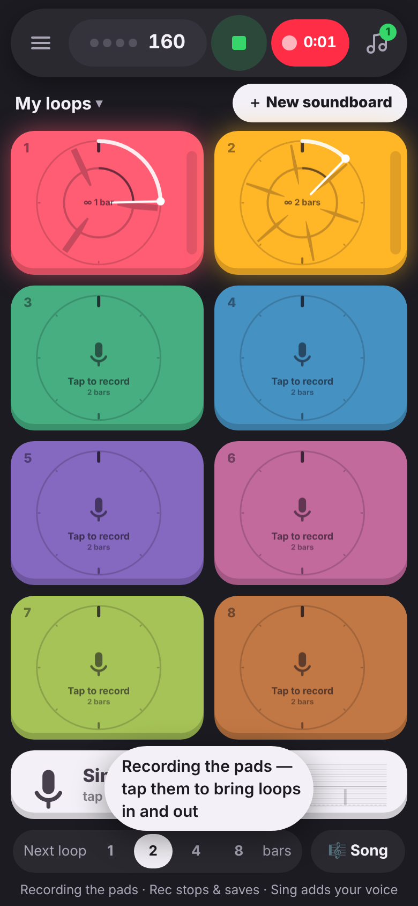
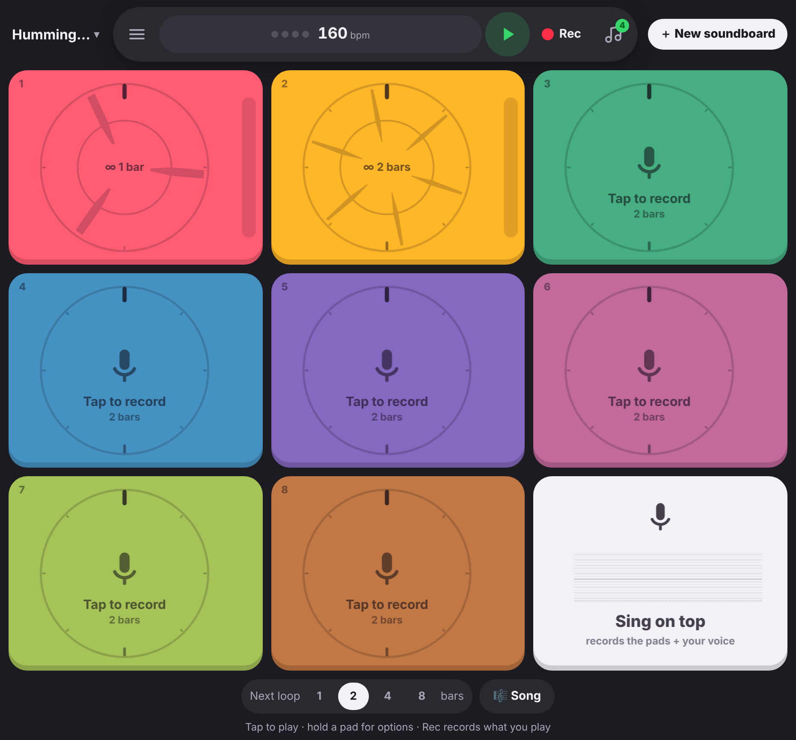

# Loopsy Doopsy

A colourful loop recorder for your phone. There are eight pads. Tap one and it counts you in, records for exactly the number of bars you chose, then starts looping in time with everything else. Each pad shows its sound as a **circular waveform**, with a playhead sweeping round it, so you can always see where the loop starts and how long it is.

https://github.com/user-attachments/assets/96072218-3509-495d-8163-cfc0fa2d5149

 

It's built for singing and humming: record a few vocal loops, then tap **Sing on top** to record yourself over the lot.

It's an **installable web app (PWA)** for iPhone, iPad, Android and computers. It's laid out for foldables like the **OnePlus Open** too: 2×4 pads on the cover screen, a 3×3 grid of large pads when unfolded, and pads kept clear of the fold when half-open.

## Use it on iPhone, Android or a computer (web app)

Every push to `main` publishes `www/` to **GitHub Pages**, at **https://loopsydoopsy.xyz** (custom domain; Settings → Pages must have **Enforce HTTPS** ticked, because browsers only allow the microphone on https). Open that link, then:

- **iPhone / iPad:** Safari → Share → **Add to Home Screen**.
- **Android:** Chrome → ⋮ → **Install app**.
- **Computer:** Chrome or Edge → the install icon in the address bar (Safari on a Mac: File → Add to Dock). Keys: **1–8** tap the pads, **Space** plays/stops, **R** records.

Every visit opens on **Getting started** (tips for recording and lining loops up). In a browser tab it also says **install it first** and shows the steps for their device (Menu → Getting started brings it back; Menu → Install the app has the steps too). After their first recording it reminds them once more. Installing matters: sounds are saved on the device, and browsers may clear a website's saved data if it isn't opened for a while (Safari after about a week), but they don't clear an installed app's. Once installed it also works offline.

**One-time setup:** the repo must be public (free Pages needs that), and in Settings → Pages → Build and deployment, Source must be **GitHub Actions**. Settings → General → Default branch should be `main`.

### Browsers

Chrome, Edge and Safari (iPhone, iPad and Mac) are the main targets, and Firefox works too. Firefox can't connect a microphone running at a different sample rate from the app's audio engine, so when that happens the app quietly restarts its engine at the microphone's rate (nothing is lost). Firefox on a computer can't install web apps, but it works in a tab.

### iPhone and iPad (Safari)

- **Microphone permission:** Apple makes web apps ask again each time they're opened. The first time, Loopsy shows a short "Can Loopsy use your microphone?" screen; after that it goes straight to Safari's own question. Once allowed, it stays allowed until the app is closed.
- **Sound routing:** while a microphone is open, iOS puts the phone in "call" mode, which can turn playback down or send it to the earpiece (worse on iOS 26.2+). So on iOS Loopsy sets Safari's audio session to *playback* (full volume through the speaker, even with the silent switch on), switches to *play-and-record* only while recording, and lets the microphone go a few seconds after each recording.
- **Start-up order:** the audio engine (and its recorder worklet) starts before the microphone opens, which avoids a Safari bug where audio comes out distorted.
- Recording stops if you switch apps or lock the screen; headphones (wired, or AirPods) work well.

### FAQ & suggestions

Menu → **FAQ & suggestions** has a searchable FAQ (in `www/js/help.js`, easy to add to) and a **Suggest** tab: a text box and a Send button, with nothing to sign up for. Messages go quietly into a Google Form you own, so they collect in your Google account (Responses tab, or a linked Sheet; you can turn on email notifications).

To connect it: make a Google Form with one **Paragraph** question → ⋮ → **Get pre-filled link** → type anything → **Get link** → copy it into `FEEDBACK_FORM_LINK` at the top of `www/js/help.js`. Until that's set, Send opens a pre-filled GitHub issue instead.

### What it costs to host

Nothing, and it can't run up a bill. The site is a folder of static files: there's no server, database or file storage behind it. Everyone's sounds stay on their own device (in the browser's storage), and people swap sounds by sending files through whatever they already use (WhatsApp, AirDrop, email, Drive). GitHub Pages is free and has no billing to go over: it has a soft limit of about 100 GB of traffic a month, and the whole app is under 1 MB.

## Develop

The app is plain HTML/CSS/JS in `www/`, with no build step.

```sh
npm start              # browser version on http://localhost:5173
npm test               # unit tests: timing / DSP maths and the screen layouts
npm run test:e2e       # headless Chromium with a fake mic at phone, cover-screen and unfolded sizes
```

Browsers only allow the microphone on **https** or `localhost`.

The repo used to build an Android app (APK) as well; that was retired in favour of the web app. The last version with it is in the history at commit `d63b0cd` if it's ever wanted again.

## How it plays

| Do this | What happens |
| --- | --- |
| Tap an **empty pad** | Records a loop after a **one-bar count-in**: a hand moves round the pad at the same pace as the loops (one turn = the whole loop, so on a 4-bar pad the count-in is the last quarter of the circle), and recording starts the moment it reaches the **red mark at the top** (silent unless you switch on beeps in Settings). With loops playing, it starts **together with them**: it waits (the pad says "starts with the loops") until they come round to the top, or for a shorter loop the next point they line up with it, and the hand only sweeps for the last bar. |
| Watch the **ring** while recording | It fills **red** as you record, with beat ticks round the edge. In the **last bar it turns white** and counts down "finish in 3·2·1", so you know when to stop. |
| Tap a pad **while it's recording** | Finishes early, at the next 1, 2 or 4 bar mark, so it still lines up. |
| Tap a **loop pad** | Switches it on or off. A loop always starts **from its beginning**, timed to come in when the other loops come round; the pad says "in 3" while it waits. |
| Tap a **one-shot pad** | Plays the sound once, straight away (Keezy style). Tap fast to stutter. |
| **⚙** on a pad (top left) | Options: Loop / One-shot, **volume**, **Trim & silence**, re-record, clear (with undo), **Save this sound** (downloads a WAV that remembers its tempo and length; **Share…** appears too on devices that can share files) and **Load a sound file**. On an empty pad it lets you load a sound into it. Holding a pad still works as a shortcut. |
| **▶ / ■** | Starts or stops everything. Loops you've switched on start together from the top. |
| **Next loop: 1 · 2 · 4 · 8 bars** | Sets the length of the next recording. |
| **● Rec** (top bar) | Records **just the pads**, with no mic and so no echo. Bring loops in and out while it runs, then tap Rec again to save the take. |
| **Sing on top** (the white tile) | Records the pads **plus your voice**. Tap again to stop and save. During a Rec take, tapping it adds your voice from that moment. It shows a live level meter, so you can see quiet humming is getting through. |
| **♫** | Your recorded takes: play them, share or save them as **MP3** (small, plays anywhere) or **WAV** (full quality), delete them (with undo). |
| **＋ New soundboard** | Asks whether to keep the current soundboard. **Save it** lets you name it, then you get a fresh, empty board. **Don't save** lets it go (with Undo). |
| **Soundboard name** (above the pads, tap it) | Your **Soundboards**: each keeps all eight pads' sounds and the tempo, saved as you go. Open, rename or duplicate them; **Save sounds as WAV** shares every pad's sound as its own file; **Back up / send** makes one `.loopsy` file (all sounds and settings) to keep in Drive or send to another phone, and **Open a backup** brings it back. |
| **☰ Menu** | Getting started, Soundboards, FAQ & suggestions, **Looping basics**, settings, install, and the version with **Check for updates**. |
| **Tempo** (tap the bpm) | BPM, tap tempo, time signature, count-in, mic boost, latency calibration and the rest of the settings. |

### Trim & silence (⚙ → Trim & silence)

The pad **keeps playing in time with your other loops** while you trim, with a playhead in the editor, so you hear each change from the next bar. Every recording also keeps half a bar from **before** you started and a bar from **after** you finished. The trim editor shows the whole take with the loop window highlighted over it:

- **Drag the window** to slide the loop earlier or later. It snaps to 1/16 notes, and the ‹ › buttons nudge it by 10 ms. If you came in a little early, or a little late, slide the window to fix it.
- **Overrun is cut off** automatically, so the loop always stays exactly the length you chose. If you'd rather keep a held note ringing across the seam, tick **"Wrap overrun into the start"** to fold the tail back onto the beginning of the loop, fading out.
- **Length**: choose 1, 2, 4 or 8 bars, or **Free** for a one-shot of any length. A free-length pad can't loop, because it wouldn't stay in time.
- **Move a part:** switch to "✋ Move a part", drag across a note or word to select it, then drag the selection to move just that bit (‹ › nudge it by 10 ms). Where it came from goes quiet; the loop stays the same length.
- **Silence:** drag across a breath, click or cough. It goes quiet (with tiny fades so it doesn't click) and the loop stays the same length.
- **Compare with** another pad: its sound is drawn above the line and this pad's below, lined up as they play together, so you can see where notes should meet.
- **Undo last change / Undo all changes** take back moves and silences.
- **Cancel** puts everything back the way it was.

### Updates

The app checks for a new version whenever it's opened or brought back to the front, and switches to it straight away if nothing's playing (otherwise it offers an **Update** button). It always loads the newest files when online, and the saved copy when offline.

### Crackles

Tempo & settings → **Sound** picks **Smooth** (bigger audio buffers: no crackles, a little more delay, which is measured and corrected for) or **Fast** (lowest delay, for devices that keep up). Android phones and Firefox start on Smooth. Phones also redraw at 30 frames a second and at most 2× sharpness, and sounds fade in and out over a few milliseconds when they start mid-way or stop, so nothing clicks.

### Microphones, headphones and delay

Tempo & settings → **Microphone** lets you choose which mic records (the list appears once the app has been allowed to use one). With Bluetooth headphones, the phone's own mic usually sounds better: a headset mic often drops into a muffled "phone call" mode. Every device has some delay between the speaker and the mic, which the app corrects for (Settings → Calibrate measures it). **Bluetooth headphones add more** (often around 200 ms, varying between headphones), so with them recordings can land late: wired headphones are best, or set Latency to about 200 ms and fine-tune with Trim.

### Making music with someone else

There's no account or server: you pass files back and forth.

- **A whole soundboard:** Soundboards → **Back up / send** makes one `.loopsy` file. Your friend opens it with **Open a backup**, adds their layers, and sends theirs back.
- **One sound:** a pad's ⚙ → **Save this sound** (or **Share…**), then send the file however you like. It's an ordinary WAV, with the tempo and length tucked inside it. Loaded onto a pad (⚙ on an empty pad → **Load a sound file**), it lands on the grid as a loop of the right length; an empty soundboard takes on its tempo. Voice memos, MP3s and other audio load too: as a loop if they're a whole 1, 2, 4 or 8 bars at your tempo, otherwise as a one-shot you can trim.

## Research & design notes

**Keezy** (Elepath, 2013) is the reference. It has eight coloured tiles, you record into a tile through the mic, tap to play, and press and hold to loop. Every tile is playable at once, you can save boards and share jams, and you can play one tile while recording into another, so the app can resample itself. People loved how immediate it was: there are no menus between you and the sound. ([TechCrunch](https://techcrunch.com/?p=913095), [Tinybop](https://tinybop.com/loves/apps/keezy), [App listing](https://apps.appfollow.io/ios/keezy-classic/605855595?country=us))

The **circular waveform** comes from the app in the reference screenshot. A loop *is* a circle, and a playhead sweeping round shows where you are in it. That app's problem was that the circle didn't show the loop's **length** or **where it starts**, so it was hard to come in and stop on time and get loops that line up. Loopsy Doopsy fixes this:

1. **Fixed, grid-locked lengths.** Tempo plus bar count sets the loop length before you record, and recording starts and stops on sample-exact bar lines. The audio is cut at exact frame numbers stamped by an AudioWorklet, not by a timer that might fire late. Every loop is a whole number of bars, so loops of different lengths (1, 2, 4, 8 bars) always line up.
2. **12 o'clock is always "1".** The big tick at the top marks the start of the loop, bar lines are medium ticks and beats are small ticks. You can read the loop's length and your position in it at a glance.
3. **Get-ready and wrap-up cues.** A one-bar count-in on the pad itself, drawn as a hand sweeping round to a red mark at the top so you can see exactly when to come in, beat lights in the top bar, a red progress ring while recording, and a white ring with a countdown for the last bar. Optional count-in beeps always stop before the downbeat, so they never end up in a take; there's no metronome to leak into recordings.
4. **Everything starts from the top.** A loop never comes in halfway through. It waits for the loops already playing to come round, then plays from its first beat. New recordings start on any bar line after a one-bar count-in; if that's partway through the loop cycle, the take is turned round (by whole bars) so its own beginning sits at the top of the cycle, and layers still line up the way you heard them.
5. **Forgiving capture.** Pre-roll and overrun are recorded too, so small timing mistakes can be fixed in Trim instead of re-recorded.
6. **Latency compensation.** Phones add delay between the speaker and the mic. Without compensation every overdub drifts late, which loopers like Loopy Pro and Ableton have to deal with as well ([Loopy Pro request](https://roadmap.loopypro.com/feature-requests/p/latency-adjustmentcustom-track-offset-parameter), [Cycling '74 thread](https://cycling74.com/forums/time-accuracy-and-latency-compensation)). Loopsy Doopsy estimates the delay automatically, and **Settings → Calibrate** measures it properly: it plays clicks through the speaker and listens for them. Live-mic takes are shifted back by the same amount, so your riffing lines up with the pads in the saved file.
7. **Made for voice.** **Mic boost** (Settings) adds up to +12 dB for quiet humming. A limiter on the output stops stacked vocal loops from distorting. The mic's own processing (noise suppression, auto-gain) is switched off so loops keep their natural dynamics.
8. **Foldables.** The layout picks whichever arrangement gives the biggest pads on the current screen:

   | Screen | Layout |
   | --- | --- |
   | Cover screen / phone | 2×4 pads and a Sing strip |
   | Landscape phone | 4×2 pads and a Sing strip |
   | Unfolded (near-square) | 3×3 grid, with Sing as the ninth tile |
   | Half-open like a book | Four pads either side of the fold (when Chrome reports the hinge through the viewport-segments API) |

   Folding or unfolding doesn't restart the app, so a loop keeps playing across the change.
9. **Colourful, but readable.** The eight pads have distinct bright colours with dark ink on top. Empty pads are dimmed, pads with a sound are at full colour, and pads that are playing glow.

**Headphones help a lot.** Without them, the mic picks up the loops coming out of the speaker. "Echo cancellation" in Settings reduces that, but it dulls the sound. Only turn on "Hear the mic through the app" when you're wearing headphones.

## Code map

```
www/                  the app (everything below lives in here)
.github/workflows/    publishes www/ to GitHub Pages from main

index.html            layout + sheets (pad options, trim, settings, recordings, soundboards, microphone, FAQ, looping basics)
css/style.css         styles; portrait 2×4 grid, landscape 4×2
js/main.js            UI wiring, gestures, render loop
js/engine.js          Web Audio: transport, count-in, recording, playback, session recorder, calibration
js/capture-worklet.js AudioWorklet that taps audio with frame-accurate timestamps
js/pad-view.js        canvas drawing of the circular pads
js/trim.js            trim editor
js/timing.js          pure maths (grid, loop cutting, peaks, onset detection, tap tempo) — unit-tested
js/layout.js          picks the pad grid for the screen / fold — unit-tested
js/projects.js        soundboards: save / open / new / duplicate / backup, autosave
js/boardfile.js       the .loopsy backup file format — unit-tested
js/mic.js             asking for the microphone, and help when it can't be opened — unit-tested
js/help.js            FAQ & suggestions box and its built-in guide — unit-tested
js/storage.js         IndexedDB: projects and recorded takes
js/wav.js             WAV encoder, plus the tempo/length tag on sent pad sounds — unit-tested
js/audio-files.js     MP3 export (via a worker) and reading audio files onto pads
js/mp3-worker.js      MP3 encoding off the main thread (vendor/lame.min.js, LGPL)
sw.js                 offline cache
```

## Ideas for next steps

- Bundled starter kits.
- Resampling: record a pad from the app's own output.
- Per-pad effects (pitch, filter, reverse) and a mixer view.
- Export the stems from a jam as well as the mixdown.
